

<a href="https://www.devleck.com"></a>

[**devleck.com**](https://www.devleck.com) &nbsp;·&nbsp; [**contact@devleck.com**](mailto:contact@devleck.com) &nbsp;·&nbsp; [**Instagram**](https://www.instagram.com/devleck.ia/) &nbsp;·&nbsp; [**All repositories**](https://github.com/Kin9Zeus?tab=repositories)




## Selected work

Every project below is public, with its own README: screenshots, architecture notes and the real numbers. Live sites are linked where they exist.

<table>
<tr>
<td width="33%" valign="top">
<a href="https://github.com/Kin9Zeus/UVA-edu">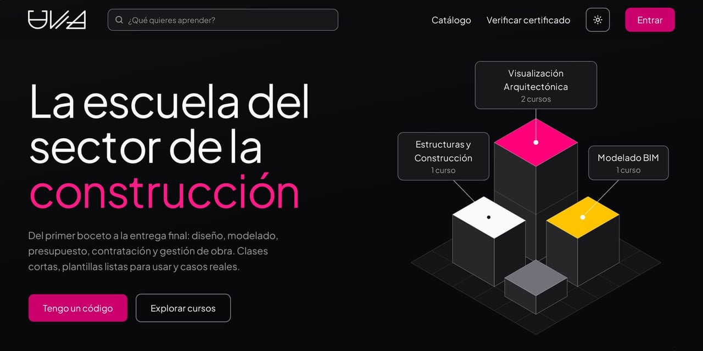</a> 
<b><a href="https://github.com/Kin9Zeus/UVA-edu">UVA · course platform</a></b> 
Online school for the construction industry: protected video, two payment gateways, AI-generated exams, QR-verifiable certificates. 
<code>Next.js</code> <code>Supabase RLS</code> <code>Mux</code> <code>Stripe</code>
</td>
<td width="33%" valign="top">
<a href="https://github.com/Kin9Zeus/Millimeter-USA">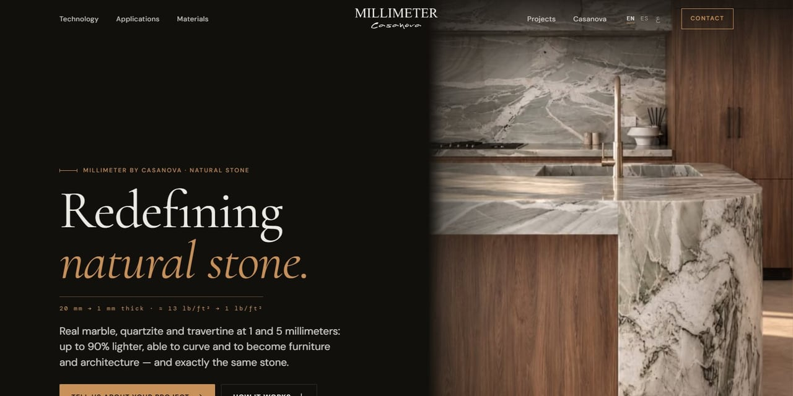</a> 
<b><a href="https://github.com/Kin9Zeus/Millimeter-USA">MILLIMETER by Casanova</a></b> · <a href="https://www.millimeterbycasanova.com/">live ↗</a> 
Trilingual brand site with scroll-driven video frames on canvas and a hardened Node edge. Lighthouse 100. 
<code>Astro</code> <code>GSAP</code> <code>Node.js</code>
</td>
<td width="33%" valign="top">
<a href="https://github.com/Kin9Zeus/Millimeter-SM-Automation">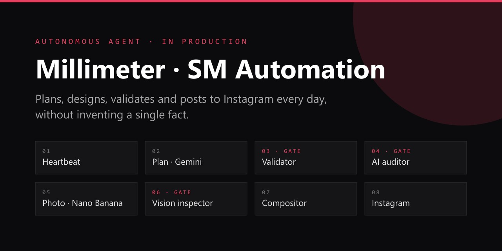</a> 
<b><a href="https://github.com/Kin9Zeus/Millimeter-SM-Automation">SM Automation</a></b> 
Autonomous agent that designs and posts to Instagram every day, behind three anti-hallucination gates. 67 tests. 
<code>Node.js</code> <code>Gemini</code> <code>Meta Graph API</code>
</td>
</tr>
<tr>
<td width="33%" valign="top">
<a href="https://github.com/Kin9Zeus/Devleck-Lead-Engine">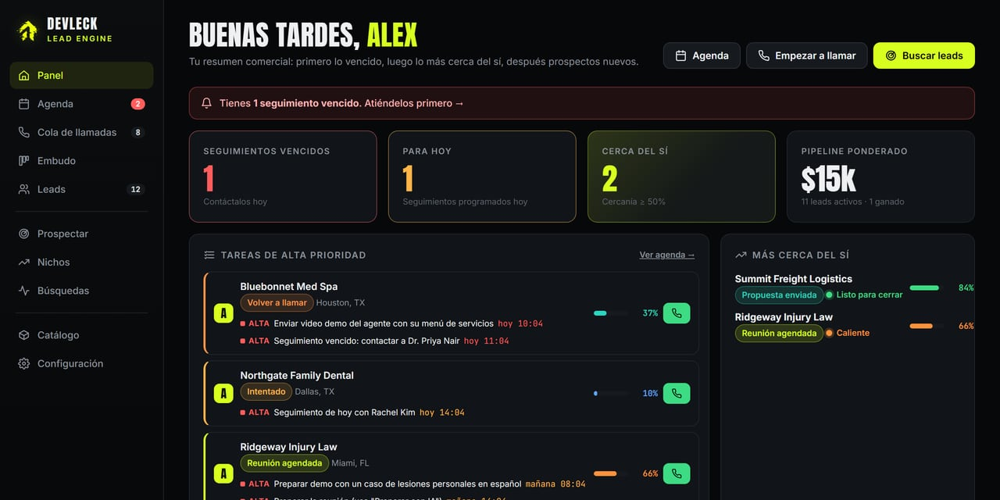</a> 
<b><a href="https://github.com/Kin9Zeus/Devleck-Lead-Engine">Devleck Lead Engine</a></b> 
B2B prospecting: Claude Code researches, verifies and qualifies leads into a ranked call queue. 
<code>Node.js</code> <code>SSE</code> <code>zero dependencies</code>
</td>
<td width="33%" valign="top">
<a href="https://github.com/Kin9Zeus/senior-engineer-skills">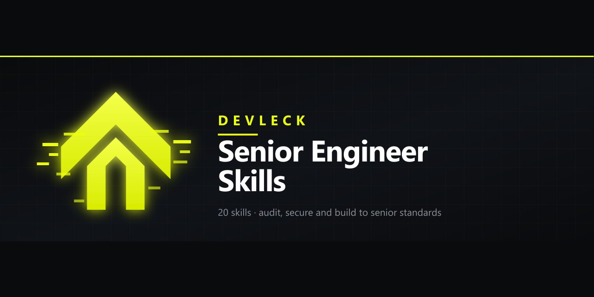</a> 
<b><a href="https://github.com/Kin9Zeus/senior-engineer-skills">Senior Engineer Skills</a></b> 
Open source: 20 skills that turn Claude Code into a senior engineering organization. MIT. 
<code>Agent Skills</code> <code>OWASP</code> <code>WCAG 2.2</code>
</td>
<td width="33%" valign="top">
<a href="https://github.com/Kin9Zeus/Vendiendo-Arquitectura-de-0-a-100-web-interactiva">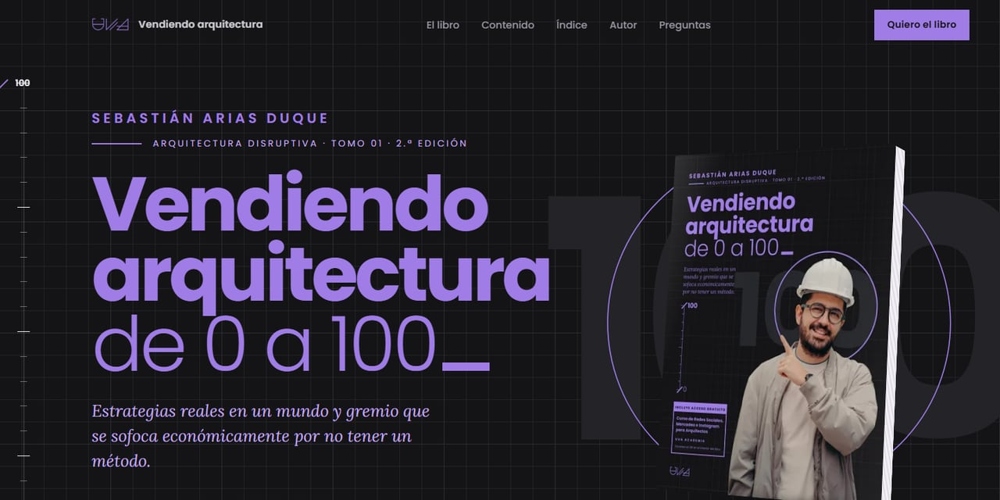</a> 
<b><a href="https://github.com/Kin9Zeus/Vendiendo-Arquitectura-de-0-a-100-web-interactiva">Vendiendo arquitectura de 0 a 100</a></b> · <a href="https://kin9zeus.github.io/Vendiendo-Arquitectura-de-0-a-100-web-interactiva/">preview ↗</a> 
Interactive book site, narrated by scroll, with a retrieval-augmented assistant. 
<code>Astro</code> <code>GSAP</code> <code>Gemini RAG</code>
</td>
</tr>
<tr>
<td width="33%" valign="top">
<a href="https://github.com/Kin9Zeus/LarqaWebDL">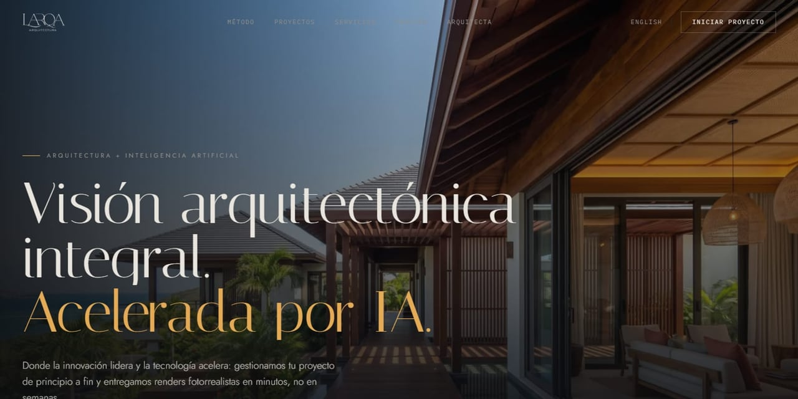</a> 
<b><a href="https://github.com/Kin9Zeus/LarqaWebDL">LARQA · Arquitectura</a></b> · <a href="https://www.larqa.co/">live ↗</a> 
3D-model-to-render comparator and a scroll-scrubbed hero for an AI-accelerated visualization studio. 
<code>Next.js</code> <code>Framer Motion</code> <code>i18n</code>
</td>
<td width="33%" valign="top">
<a href="https://github.com/Kin9Zeus/Millimeter-South-America">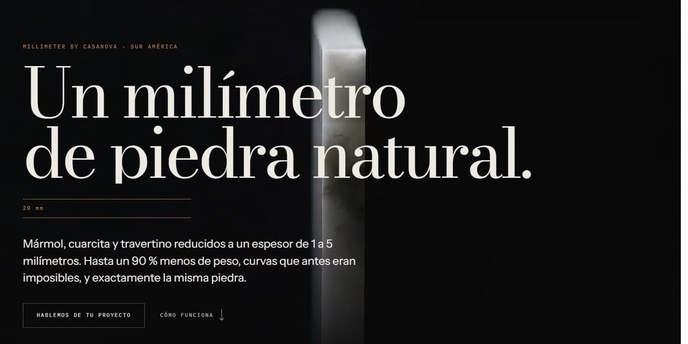</a> 
<b><a href="https://github.com/Kin9Zeus/Millimeter-South-America">MILLIMETER · S. America</a></b> · <a href="https://www.millimetersouthamerica.com/">live ↗</a> 
Four languages including right-to-left Arabic, 48 static pages, strict CSP and zero third-party requests. 
<code>Astro</code> <code>Tailwind</code> <code>Express</code>
</td>
<td width="33%" valign="top">
<a href="https://github.com/Kin9Zeus/360-coating-solutions">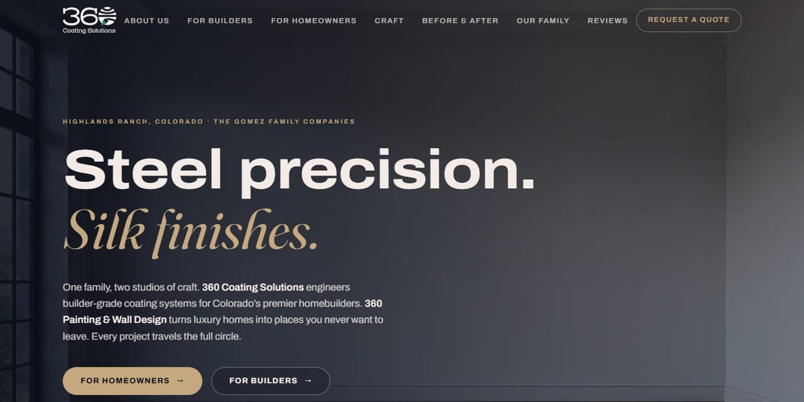</a> 
<b><a href="https://github.com/Kin9Zeus/360-coating-solutions">360 Coating Solutions</a></b> · <a href="https://www.360coatingsolutions.com/">live ↗</a> 
Scroll-driven site: a 72-frame canvas hero, GSAP choreography and an Express contact API. 
<code>React</code> <code>Vite</code> <code>GSAP</code>
</td>
</tr>
<tr>
<td width="33%" valign="top">
<a href="https://github.com/Kin9Zeus/UVAWebDL">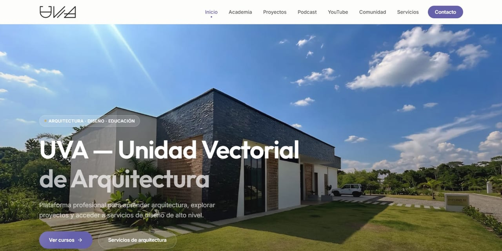</a> 
<b><a href="https://github.com/Kin9Zeus/UVAWebDL">UVA Web 2.0</a></b> · <a href="https://www.uvarq.com/">live ↗</a> 
14 course landings, a Gemini sales assistant and server-side conversion tracking. 
<code>Next.js</code> <code>MongoDB</code> <code>Meta CAPI</code>
</td>
<td width="33%" valign="top">
<a href="https://github.com/Kin9Zeus/Emeralds-By-Tatiana-de-la-Torre">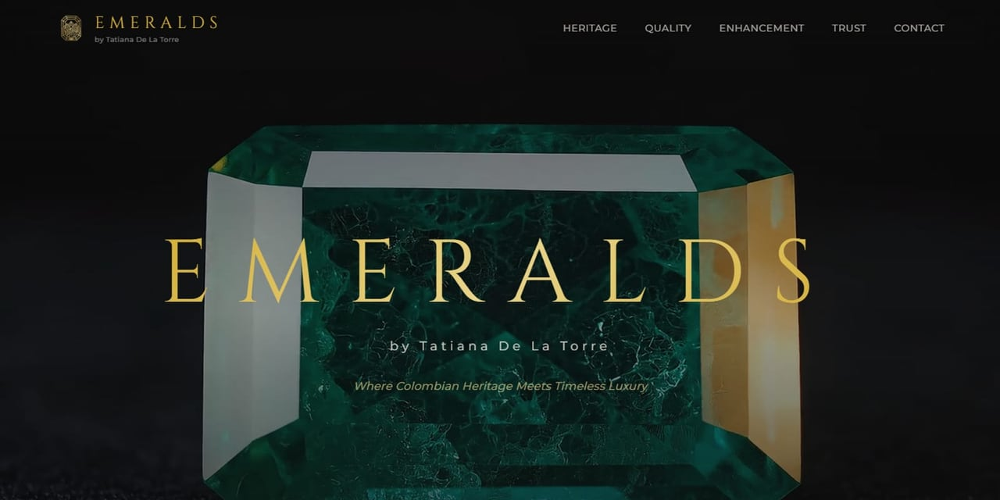</a> 
<b><a href="https://github.com/Kin9Zeus/Emeralds-By-Tatiana-de-la-Torre">Emeralds by Tatiana De La Torre</a></b> · <a href="https://www.emeraldsbytatiana.com/">live ↗</a> 
Luxury site with a pinned horizontal gallery, Lenis smooth scroll and JSON-LD structured data. 
<code>Next.js</code> <code>GSAP</code> <code>Lenis</code>
</td>
<td width="33%" valign="middle" align="center">
<a href="https://github.com/Kin9Zeus?tab=repositories"></a>
</td>
</tr>
</table>

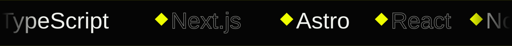

## How I work

<table>
<tr>
<td width="33%" valign="top"><b>Fixed price per phase</b> Scope and price are agreed before anyone writes code, phase by phase.</td>
<td width="33%" valign="top"><b>Working software every week</b> A weekly demo of something you can click, not slides or status reports.</td>
<td width="33%" valign="top"><b>Direct line to the engineer</b> You talk to the person who builds your product, with no hand-off after the proposal.</td>
</tr>
</table>

<a href="mailto:contact@devleck.com"></a>

<b>ES</b> · Estudio de ingeniería de software en Colombia: desarrollo a medida, automatización e IA. Trabajo en remoto con clientes de toda Latinoamérica, España y Estados Unidos.

---

Source code is published for portfolio and evaluation; see each repository's license. Brand names, logos and images belong to their respective owners.

